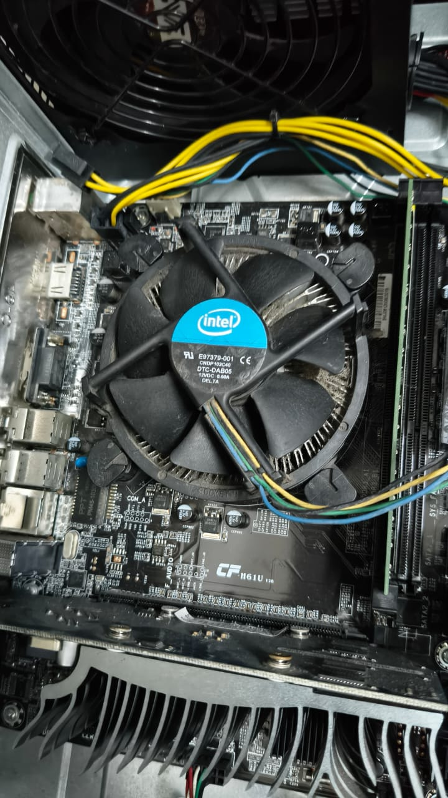
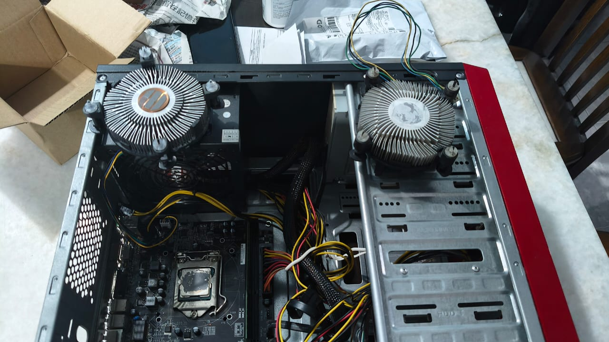
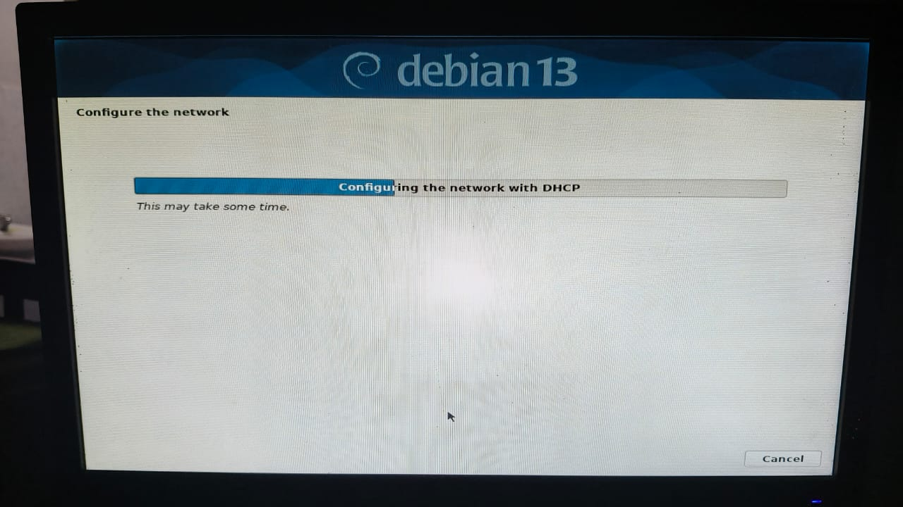
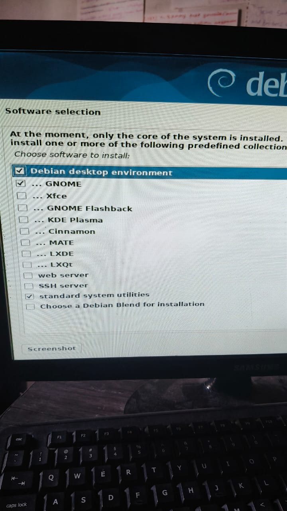
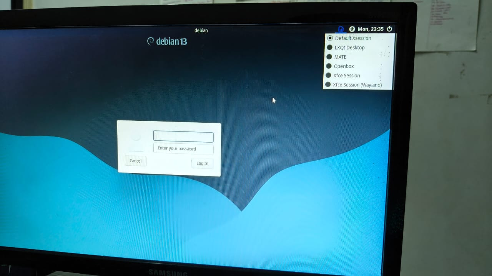

#### Linux Installation & System Optimization — Debian 13 (Trixie)

## Introduction

This project is about my journey of exploring Linux, specifically Debian 13 (Trixie), using my old desktop PC.

I started this project because my old PC was becoming slow and struggling with its hardware limitations while running Windows. Instead of replacing the entire computer, I decided to explore Linux as an alternative operating system.

Throughout this project, I learned about Linux installation, hardware maintenance, system configuration, troubleshooting, and different desktop environments.

This was not only about making my old PC usable again, but also about gaining practical experience with Linux and understanding how hardware and software work together.

## Project Objectives

- Give my old desktop PC a second life using Debian Linux.
- Learn how to install and configure a Linux operating system.
- Explore different Linux desktop environments.
- Troubleshoot hardware, software, and system-related issues.
- Improve my practical knowledge of Linux system administration.
## Hardware Specifications

This project was carried out using my old desktop PC, which has limited hardware resources.

| Component | Specification |
|---|---|
| Processor | Intel Core i3-3220 @ 3.30 GHz |
| RAM | 4 GB |
| Operating System | Debian 13 (Trixie) |
| System Storage | 500 GB Seagate HDD |
| Secondary Storage | 500 GB Toshiba HDD |
| Desktop Environment | LXQt |
| CPU Cooler | Cooler Master i70 |
| Wireless Adapter | TP-Link TL-WN722N (v2/v3) |

### Why I Used This Hardware

Instead of purchasing a new computer, I wanted to explore how much I could improve my existing PC through hardware maintenance and operating system optimization.

Since the computer only has 4 GB of RAM and an older processor, I decided to experiment with lightweight Linux desktop environments to make the system more responsive.

This also gave me an opportunity to understand how older hardware can still be useful for learning Linux, networking, and basic system administration.

## Hardware Maintenance & Upgrades

Before fully exploring Debian Linux, I performed several hardware maintenance tasks on my old desktop PC to improve its condition and prepare it for continued use.

### 1. CPU Cooling System

One of the first things I worked on was the CPU cooling system.

I initially used the original Intel stock cooler and later experimented with another Intel cooler with a copper core. Eventually, I replaced it with a Cooler Master i70.

During this process, I also cleaned the CPU surface and applied new thermal paste before installing the cooler.

**What I learned:**
- How to remove and install a CPU cooler.
- The importance of proper thermal paste application.
- How CPU cooling affects system temperature and stability.
- Basic precautions when handling computer components.

### 2. Storage Installation

I also installed a secondary 500 GB Toshiba HDD alongside the existing 500 GB Seagate system drive.

The secondary drive was later used for my Debian home server project, where I configured an ext4 filesystem and organized directories for file synchronization and storage.

**What I learned:**
- How to install and connect a SATA hard drive.
- How Linux identifies storage devices.
- The basics of disk partitioning, mounting, and filesystems.
- The importance of checking storage health and system logs when troubleshooting drive problems.

### 3. Hardware Limitations

My desktop PC uses an Intel Core i3-3220 processor and 4 GB of RAM. These specifications limited how smoothly some operating systems and desktop environments could run.

Instead of upgrading every component, I focused on maintaining the existing hardware and experimenting with software configurations.

This helped me understand how hardware limitations influence operating system performance and why choosing suitable software is important for older computers.

## Debian 13 (Trixie) Installation

After completing the initial hardware maintenance, I decided to replace Windows with Debian 13 (Trixie) to explore Linux and improve the usability of my old desktop PC.

This was also an opportunity for me to learn how an operating system is installed and configured from scratch.

### 1. Creating a Bootable USB

I downloaded the Debian 13 installation image from the official Debian website and used Rufus to create a bootable USB drive.

I then booted my desktop PC from the USB drive to begin the Debian installation process.

**What I learned:**
- How to create a bootable USB using Rufus.
- How to boot a computer from installation media.
- The basic steps involved in installing an operating system.

### 2. Installation Challenges

The installation process was not completely smooth.

During my first attempt, I encountered an installation failure related to the base system. I had to retry the installation before successfully getting Debian running.

I also initially explored the possibility of keeping Windows alongside Debian through dual booting. However, the dual-boot setup was unsuccessful, and I eventually decided to use Debian as the main operating system.

**Challenges encountered:**
- Base system installation failure during the initial attempt.
- Difficulties setting up dual boot with Windows.
- Learning how Linux installation and storage configuration differ from Windows.

### 3. Successful Installation

After resolving the installation difficulties, I successfully installed Debian 13 (Trixie) on my desktop PC.

I continued configuring the operating system, installing the necessary software, and experimenting with different desktop environments.

This was an important milestone because I could finally use Linux directly on physical hardware instead of relying only on a virtual machine.

### 4. What I Learned

Through this installation process, I gained practical experience in:

- Installing Debian Linux on physical hardware.
- Understanding the basic Linux installation process.
- Working with bootable installation media.
- Troubleshooting installation failures.
- Learning about operating system configuration and disk management.

Although the installation required several attempts, it helped me become more confident in working with Linux systems.

## Desktop Environment Experiments

After successfully installing Debian 13 (Trixie), I started exploring different Linux desktop environments to find one that would work well with my old PC.

Since my computer only has 4 GB of RAM and an Intel Core i3-3220 processor, I wanted a desktop environment that was lightweight, responsive, and suitable for everyday use.

During this process, I experimented with Xfce, KDE Plasma, MATE, and LXQt.

### 1. KDE Plasma

I also experimented with KDE Plasma, including its X11 and Wayland sessions.

KDE Plasma offered a modern desktop interface and many customization options. However, I continued exploring other environments to find a configuration that suited my older hardware.

### 2. MATE

MATE was another desktop environment I tested during my experiments.

This helped me understand how Linux allows users to choose different desktop interfaces without replacing the entire operating system.

### 4. LXQt and Xfce — My Preferred Desktop Environments

After experimenting with several desktop environments, I decided to keep both LXQt and Xfce as my preferred choices for Debian 13 (Trixie).

I selected these two environments because they are relatively lightweight and suitable for my older hardware configuration.

**LXQt**
- Provides a lightweight and responsive desktop experience.
- Suitable for my Intel Core i3-3220 processor and 4 GB of RAM.
- Offers a simple interface for everyday Linux usage.

**Xfce**
- Provides a traditional desktop interface with customization options.
- Allows me to explore a different desktop experience.
- Gives me another option when working with Debian Linux.

During my experiments, I encountered some freezing issues with Xfce. However, I continued exploring it alongside LXQt rather than removing it from my preferred desktop environments.

### Final Outcome

Both LXQt and Xfce became my preferred desktop environments for this project.

This experience helped me understand that Linux allows users to experiment with different desktop environments and select configurations based on their hardware requirements and personal preferences.

### What I Learned

Through these experiments, I learned:

- The differences between Linux desktop environments.
- How desktop environments can affect resource usage and usability.
- The basics of X11 and Wayland display sessions.
- How to troubleshoot desktop stability issues.
- The importance of selecting software based on hardware capabilities.

This experience helped me understand that installing Linux is only the beginning. Choosing and configuring the right software is equally important, especially when working with older computers.

## Problems Encountered & Troubleshooting

Throughout this project, I encountered several technical issues while installing, configuring, and using Debian 13 (Trixie).

Instead of immediately giving up or replacing the operating system, I tried to understand the problems and explore possible solutions.

### 1. Wi-Fi Connectivity Issues

I encountered difficulties configuring my TP-Link TL-WN722N USB Wi-Fi adapter on Debian.

This gave me an opportunity to learn more about Linux network interfaces, wireless adapters, drivers, and connectivity troubleshooting.

### 2. Audio Configuration Issues

I also experienced audio problems when connecting my headset to the desktop PC.

I investigated the audio configuration and eventually managed to get the headset working through the rear audio port.

This helped me gain experience troubleshooting Linux audio devices and working with PipeWire.

### 3. Desktop Environment Stability

While experimenting with different desktop environments, I experienced freezing issues, particularly with Xfce.

I compared different desktop environments and continued experimenting with LXQt and Xfce as my preferred options.

### 4. Software and System Configuration

I encountered several challenges while configuring applications and managing software on Debian.

These experiences helped me become more familiar with installing packages, managing applications, and troubleshooting Linux system configurations.

### Lessons Learned

Through these challenges, I gained experience in:

- Investigating Linux hardware and software compatibility issues.
- Troubleshooting network connectivity and audio problems.
- Understanding how desktop environments affect system stability.
- Using Linux system configuration tools.
- Developing a more systematic approach to identifying and resolving technical problems.

One of the biggest lessons I learned is that troubleshooting is an important part of working with Linux. Each issue gave me an opportunity to understand the operating system better.

## Final Results & Lessons Learned

### Project Results

After experimenting with Debian 13 (Trixie), hardware maintenance, and different desktop environments, I managed to give my old desktop PC a second life.

Instead of leaving the computer unused or replacing it with a new one, I continued using it to explore Linux and develop my technical skills.

Some of the main outcomes of this project include:

- Successfully installed Debian 13 (Trixie) as the main operating system.
- Performed hardware maintenance, including CPU cooler replacement and thermal paste application.
- Experimented with multiple desktop environments and selected LXQt and Xfce as my preferred choices.
- Troubleshot Wi-Fi connectivity, audio configuration, and desktop stability issues.
- Gained practical experience using Linux commands, managing software, and configuring the operating system.
- Prepared the computer for further experiments involving Linux system administration and home server development.

### Lessons Learned

This project taught me that older computers can still be useful for learning and experimenting with technology.

I also learned that installing an operating system is not always straightforward. Sometimes, problems occur because of hardware compatibility, software configuration, or system limitations.

Through this experience, I improved my understanding of:

- Linux installation and system configuration.
- Computer hardware maintenance.
- Linux desktop environments.
- Basic system troubleshooting.
- Hardware and software compatibility.
- Problem-solving through practical experimentation.

### Future Improvements

Although I have achieved my initial objectives, there are still several areas I would like to explore:

- Improve my Linux command-line and system administration skills.
- Learn more about monitoring system performance and resource usage.
- Explore Linux networking and remote system management.
- Continue documenting technical problems and their solutions.
- Experiment with additional Linux tools and services.

### Conclusion

This project started with a simple idea: making my old desktop PC usable again.

However, it eventually became an opportunity for me to explore Linux, understand computer hardware, and develop practical troubleshooting skills.

The experience also encouraged me to continue learning about Linux system administration, networking, and IT infrastructure.

For me, this project is not just about installing Debian Linux. It represents the beginning of my journey into working with Linux systems and understanding how computers operate beyond everyday usage.

## Screenshot

### Hardware 

### New Fan

### Debian 13: Trixie Installation

